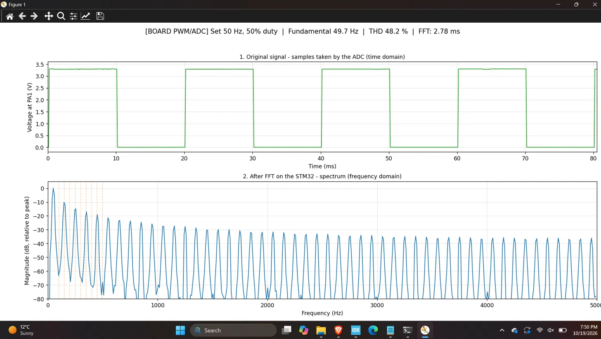
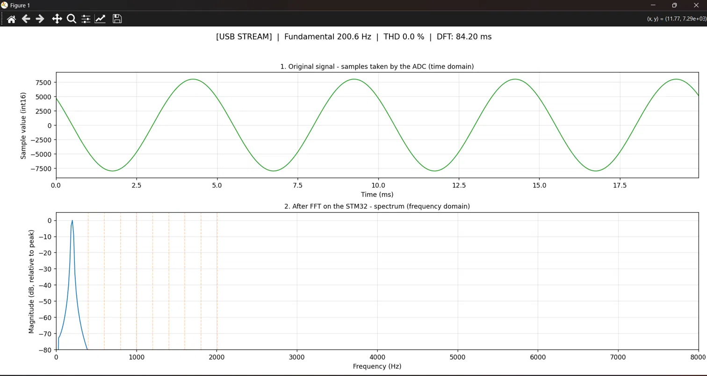
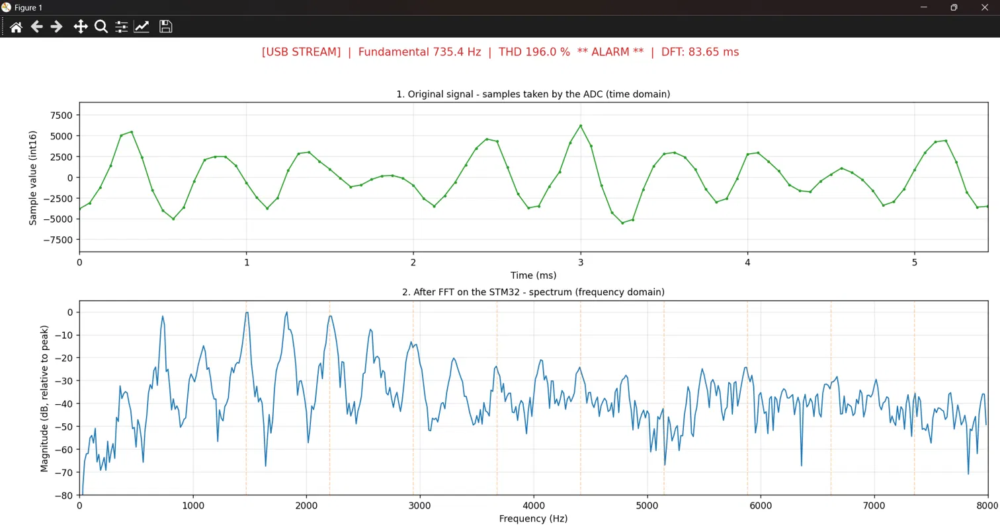
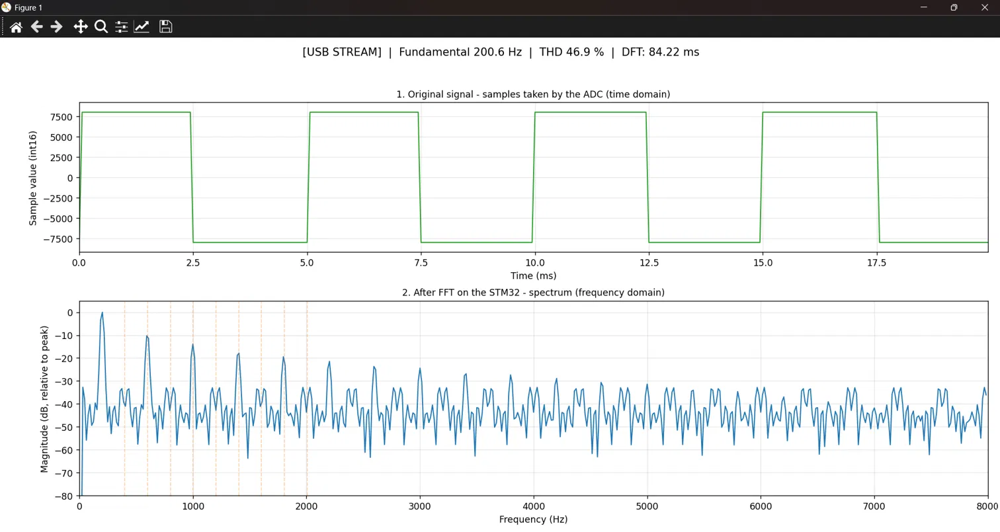
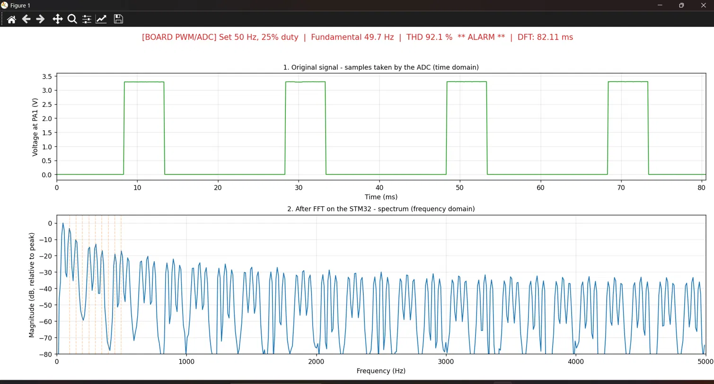
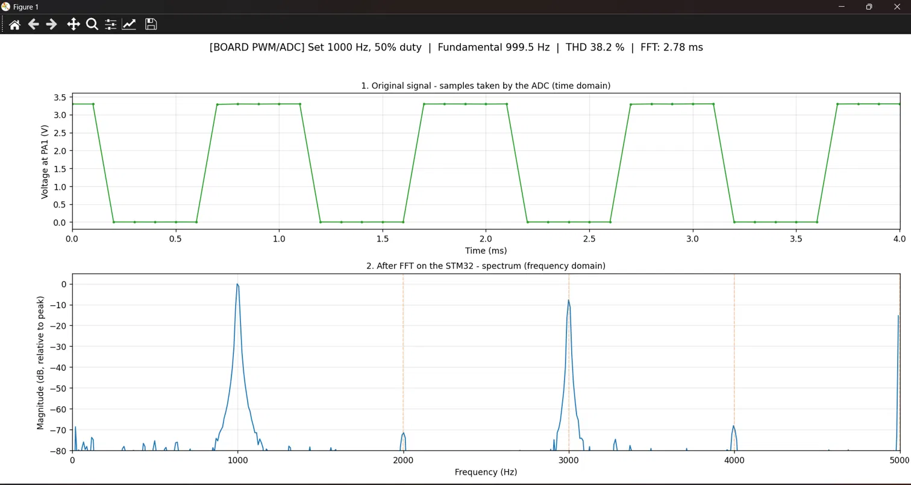
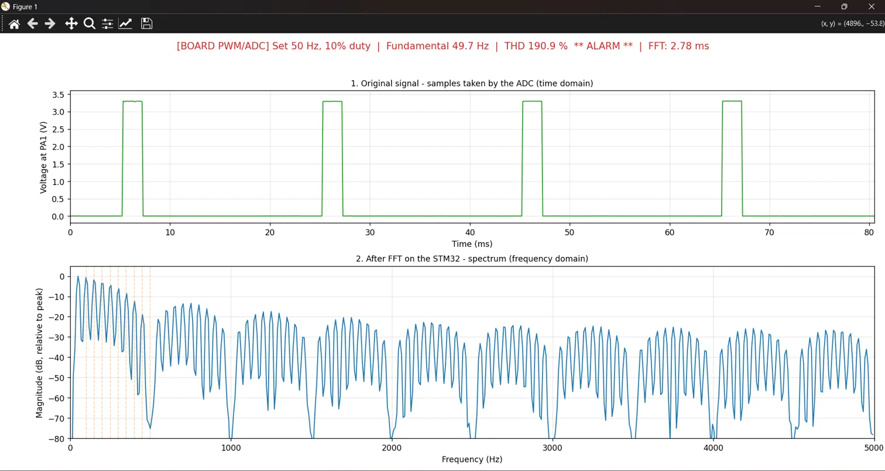

# STM32-Based Real-Time Harmonic Distortion (THD) Analyzer Using FFT

A real-time signal analysis project using an STM32 microcontroller to acquire signal samples, perform frequency-domain analysis, and visualize the spectrum on a PC using Python.

## Overview

This project is designed around the **STM32F411CEU6** microcontroller, based on the **ARM Cortex-M4F** core. It combines embedded firmware with a Python-based visualization script to support signal analysis and harmonic distortion measurement.

The firmware project is developed using **STM32CubeIDE**, while **USB Communication Device Class (USB CDC)** is used for communication between the microcontroller and the computer.

## Hardware and Software

| Component | Technology |
|---|---|
| Microcontroller | STM32F411CEU6 |
| Processor core | ARM Cortex-M4F |
| Firmware development | STM32CubeIDE |
| Firmware language | C |
| Signal processing | Fast Fourier Transform (FFT) |
| PC visualization | Python |
| Communication interface | USB CDC |

## Repository Structure

```text
STM-32-based-Real-Time-Harmonic-Distortion-THD-Analyzer-using-FFT/
├── Firmware/
│   └── fft_analyzer/
│       ├── Core/
│       ├── Drivers/
│       ├── Middlewares/
│       ├── USB_DEVICE/
│       └── fft_analyzer.ioc
├── Python/
│   └── spectrum_plot.py
├── Documentation/
├── .gitignore
├── LICENSE
└── README.md
```

*Note: The structure above highlights the main project components; additional configuration and source files are included in the repository.*

## Key Components

- **Embedded firmware:** STM32CubeIDE project for the STM32F411CEU6 microcontroller.
- **Signal acquisition:** ADC-related firmware for acquiring input samples.
- **Frequency analysis:** FFT-based signal processing.
- **USB communication:** USB CDC interface for transferring data between the microcontroller and PC.
- **Spectrum visualization:** Python script for displaying signal spectrum data.

The exact implementation and operational status of individual features should be verified against the firmware source code and the Python script.

## Getting Started

### 1. Firmware Setup

1. Install **STM32CubeIDE**.
2. Clone or download this repository.
3. Import the `Firmware/fft_analyzer` project into STM32CubeIDE.
4. Check the target microcontroller, project configuration, and required dependencies.
5. Build the firmware and program compatible STM32 hardware.

### 2. Python Setup

1. Install **Python 3**.
2. Open the `Python` directory.
3. Review `spectrum_plot.py` to identify its required Python packages and communication settings.
4. Install the required dependencies.
5. Connect the compatible hardware and configure the appropriate communication port.
6. Run the script using Python.

### 3. Hardware Considerations

- Verify the signal input range and ADC input requirements before connecting an external signal.
- Confirm the USB connection and communication settings.
- Check the firmware's sampling configuration, FFT implementation, and THD calculation before relying on measurement results.

## Results and Visualizations

The Python visualization script displays the sampled input signal in the time domain and its frequency spectrum after FFT processing on the STM32.

### 1. PWM Signal Tests

**50 Hz PWM — 50% Duty Cycle**

Measured fundamental: 49.7 Hz · Measured THD: 48.2% · Alarm LED: OFF



**50 Hz PWM — 25% Duty Cycle**

Measured fundamental: 49.7 Hz · Measured THD: 92.1% · Alarm LED: ON



**50 Hz PWM — 10% Duty Cycle**

Measured fundamental: 49.7 Hz · Measured THD: 190.9% · Alarm LED: ON



**1 kHz PWM — 50% Duty Cycle**

Measured fundamental: 999.5 Hz · Measured THD: 38.2% · Alarm LED: OFF



### 2. Sine-Wave Input

The displayed 200 Hz sine-wave test shows a dominant fundamental peak and a reported THD of 0.0%.



### 3. Additional USB-Stream Tests

The following screenshots show additional signals received through the USB stream. Their displayed THD values depend on the input signal.

**Square-Wave Input**

Displayed fundamental: 200.6 Hz · Displayed THD: 46.9%



**Distorted Input Signal**

Displayed fundamental: 735.4 Hz · Displayed THD: 196.0% · Displayed processing mode: DFT



### 4. FFT and DFT Performance

The project report records the following processing times for the standard test profiles:

| Processing method | Reported processing time |
|---|---:|
| FFT | 2.78 ms |
| DFT | 82.11 ms |

These values are from the project report; the individual screenshots may show different processing times depending on the selected processing mode and input.

## License

See the [`LICENSE`](LICENSE) file for the license terms applicable to this repository.